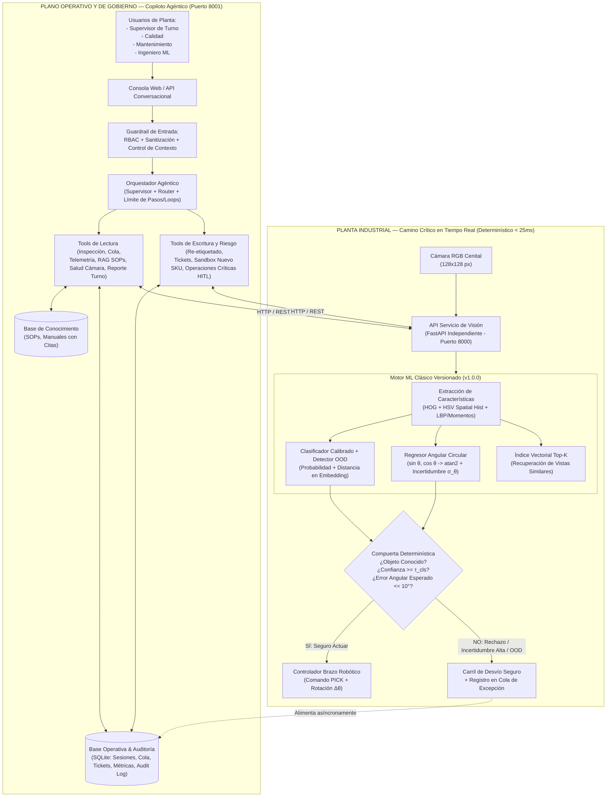
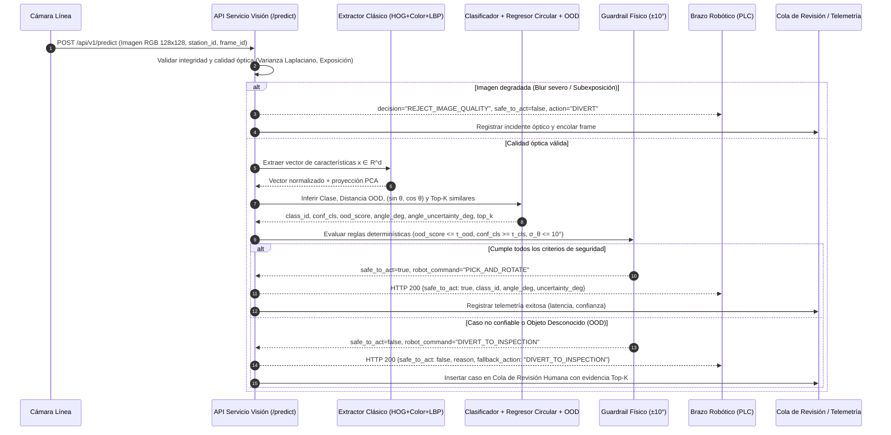
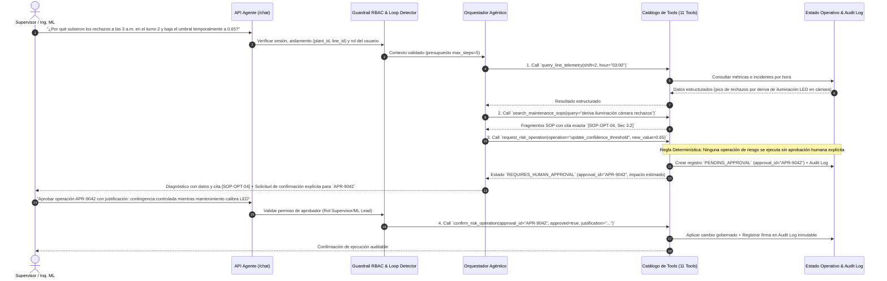

# =============================================================================
# Arquitectura y Diagramas de Secuencia — Sistema IA Pick & Pack (Indra Group)
# =============================================================================

## 1. Principio de Diseño: Separación entre Camino Crítico Determinístico y Plano Agéntico

El problema industrial exige **alta cadencia (throughput de línea 24/5)**, **seguridad física para el brazo robótico (tolerancia de agarre $\pm 10^\circ$)** y **gobernanza operativa**.

| Dimensión | Camino Crítico en Línea (Visión + Compuerta Robot) | Plano de Control y Excepciones (Asistente Agéntico) |
|---|---|---|
| **Naturaleza** | **100% Determinístico** (ML Clásico + Estadística Circular + Guardrail Matemático) | **Agéntico Gobernado** (Orquestador + Tools tipadas + RBAC + Human-in-the-Loop) |
| **Ubicación** | **Edge / Planta Local** (Acoplado a cámara industrial y controlador PLC/Robot) | **Out-of-Band (Plano de Supervisión)** (Sin bloquear el ciclo de agarre) |
| **Latencia** | **< 25 ms** en CPU estándar (determinista, sin red externa) | **0.5 s – 4.0 s** (Consultas interactivas de supervisores, calidad, mantenimiento, ML) |
| **Costo Marginal** | **~\$0.00 por imagen** (Cómputo local amortizado) | **Bajo demanda** (Solo se invoca ante excepciones, diagnósticos o auditorías) |
| **Riesgo Mitigado** | Evita alucinaciones de LLMs, variabilidad de red y paradas no programadas en el brazo robótico | Evita acciones destructivas mediante permisos estrictos (RBAC) y aprobación humana explícita (HITL) |

---

## 2. Diagrama de Arquitectura General del Sistema



---

## 3. Diagrama de Secuencia 1: Flujo Crítico `Imagen -> Robot` (Determinístico)



---

## 4. Diagrama de Secuencia 2: Flujo Agéntico Complejo con Aprobación Humana (HITL)

Caso ilustrado: **Diagnóstico de incremento de rechazos + Solicitud de Operación de Riesgo (Ajuste de umbral / Envío de comando o Promoción de modelo) con Aprobación Humana Explícita**.



---

## 5. Estructura del Repositorio

```text
prueba-tecnica-ingeniero-ia-indra/
├── .env.example                       # Configuración parametrizada sin secretos (Reto 4)
├── Dockerfile                         # Empaquetado reproducible de servicios
├── docker-compose.yml                 # Orquestación local de 1 comando (Visión + Agente)
├── pyproject.toml                     # Definición del paquete y configuración de tests
├── requirements.txt                   # Dependencias fijadas
├── README.md                          # Mapa maestro de entregables y guía de ejecución rápida
├── data/
│   ├── raw/                           # Dataset COIL-100 descargado automáticamente
│   ├── processed/                     # Particiones estrictas (Protocolos A, B, C, D) y features
│   └── knowledge_base/                # SOPs, manuales técnicos y procedimientos de planta
├── models/                            # Artefactos versionados (.joblib) y Model Card (.json/.md)
├── notebooks/                         # Entregable #2: Notebook reproducible de punta a punta (.ipynb)
├── src/
│   ├── config.py                      # Configuración centralizada (Pydantic Settings)
│   ├── ml/                            # Reto 2: Extracción clásica, clasificadores, regresor circular, OOD
│   ├── vision_service/                # Reto 4: API FastAPI independiente de inferencia de visión
│   ├── agent_service/                 # Reto 3: Orquestador agéntico, estado, memoria, RBAC y seguridad
│   │   └── tools/                     # Catálogo de 11 tools de lectura/escritura con contratos estrictos
│   └── ui/                            # Consola interactiva para defensa técnica en vivo
├── scripts/                           # Scripts reproducibles de entrenamiento, evaluación (30+ casos) y PDFs
├── tests/                             # Suite de tests unitarios, protocolos y 8 escenarios adversos
└── docs/
    ├── architecture/                  # Diagramas de arquitectura y secuencia (Reto 4)
    └── deliverables/                  # Entregables oficiales (#3 Reporte PDF, #7 Tools, #8 Threat Model, #12 Azure FinOps)
```
