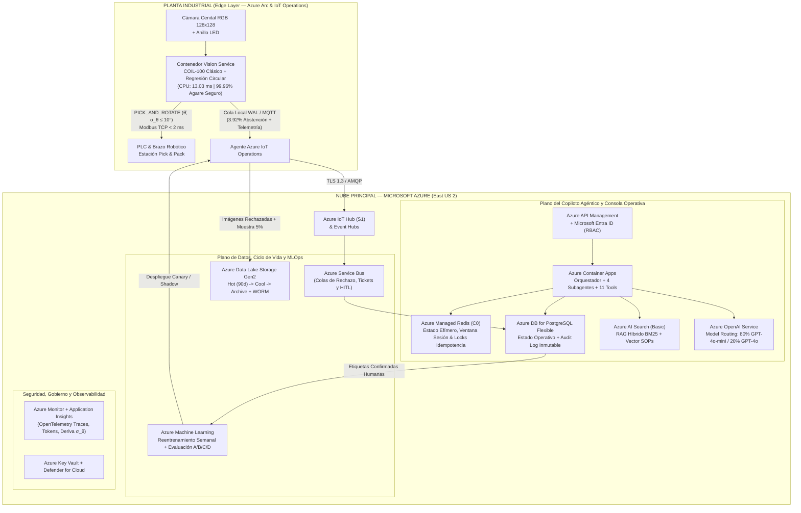

# Entregable #12 — Arquitectura Cloud Híbrida (Edge + Azure), Comparativa AWS y Modelo FinOps

**Prueba Técnica AI Engineer (Senior+) — Indra Group**  
**Reto 6:** Arquitectura en la Nube, Ciclo de Vida del Dato, FinOps y Caso de Negocio (3 Turnos)

---

## 1. Visión Arquitectónica y Decisión Clave de Ingeniería (Edge-First + Cloud-Governed)

En una línea industrial de *Pick & Pack* que opera 3 turnos continuos (`135,000 objetos/mes` por estación a ráfagas de hasta 15 piezas/minuto con restricción de control PLC `< 50 ms`), enviar cada frame de cámara a la nube o invocar un modelo multimodal (VLM) por pieza sería **técnica y económicamente inviable** (alta latencia WAN, riesgo de parada por corte de internet y costo desbordado de tokens/GPU).

Por ello, nuestra arquitectura implementa un patrón **Híbrido Edge-to-Cloud con Separación de Planos**:

1. **Plano de Inferencia Determinística en el Edge (Planta — `< 15 ms`, Offline-First)**:
   - El microservicio `indra-vision-service` (`COIL100ClassicalSystem`: HOG + Histogramas HSV/RGB + Perfil Azimutal + Regresión Circular $(\sin	heta, \cos	heta)$) corre localmente en un **IPC Industrial gestionado por Azure Arc / Azure IoT Operations** sobre CPU estándar (`13.03 ms` por imagen, **$0 USD de costo por inferencia en la nube**).
   - Solo se transmiten a la nube: (a) telemetría agregada por minuto/turno, (b) el **3.92%** de imágenes rechazadas o con incertidumbre angular $\sigma_	heta > 10^\circ$ para revisión humana y reentrenamiento, y (c) un muestreo de auditoría del **5%**.
2. **Plano de Control Agéntico, RAG, HITL y MLOps en Microsoft Azure**:
   - El **Copiloto Operativo Multiagente** (`indra-agent-copilot`) se despliega en **Azure Container Apps**, conectado a **Azure OpenAI Service** (con *Model Routing* 80% `GPT-4o-mini` / 20% `GPT-4o`), **Azure AI Search** (búsqueda híbrida BM25 + vectorial sobre SOPs), **Azure Database for PostgreSQL Flexible Server** (estado operativo y `audit_log` inmutable) y **Azure Machine Learning** (reentrenamiento semanal con etiquetas confirmadas por humanos).

---

## 2. Justificación de Servicios y Trade-offs Arquitectónicos en Azure

| Capa | Servicio Elegido en Azure | Alternativa Descartada | Justificación Técnica y Económica (Trade-off) |
| :--- | :--- | :--- | :--- |
| **Inferencia de Visión** | **Contenedor en Edge (Azure Arc + IPC CPU)** | Endpoint GPU en la nube (Azure ML Managed Online Endpoint) | Inferir 135,000 imágenes/mes en GPU cloud costaría >$380/mes y añadiría 80–150 ms de latencia WAN. En CPU Edge tarda **13.03 ms**, cuesta **$0 en cloud** y opera *offline*. |
| **Hosting del Agente** | **Azure Container Apps (ACA)** | Azure Kubernetes Service (AKS) o Azure Functions | AKS introduce sobrecosto operativo y nodos de sistema para 1–10 estaciones; Functions limita ejecuciones largas o conexiones persistentes. ACA escala con KEDA y cuesta **~$34.80/mes**. |
| **LLM del Agente** | **Azure OpenAI con Enrutamiento (`80% GPT-4o-mini` / `20% GPT-4o`)** | `100% GPT-4o` o `Provisioned Throughput (PTU)` | Usar 100% GPT-4o quintuplica el gasto de tokens sin ganancia en llamadas determinísticas a tools. PTU solo es rentable sobre >50 plantas. El enrutamiento híbrido cuesta **~$14.70/mes** por estación. |
| **Motor RAG (SOPs)** | **Azure AI Search (Tier Basic)** | Vector DB dedicada (Pinecone Enterprise) | Los SOPs de planta contienen códigos alfanuméricos exactos (`SOP-OPT-04`, `ERR-PLC-504`). La búsqueda híbrida (BM25 + Vectores) de Azure AI Search supera al vector puro por **$75.10/mes** compartido entre hasta 10 estaciones. |
| **Base de Estado** | **Azure DB for PostgreSQL Flexible + Azure Managed Redis** | Azure Cosmos DB multi-región | Las tablas operativas (`rejection_queue`, `maintenance_tickets`, `risk_operation_approvals`, `audit_log`) exigen integridad transaccional ACID y consultas relacionales por turno. |

---

## 3. Ciclo de Vida del Dato, Retención y Cumplimiento Industrial

| Tipo de Dato / Artefacto | Almacenamiento Primario | Política de Retención y Tiering | Controles de Seguridad y Privacidad |
| :--- | :--- | :--- | :--- |
| **Imágenes Nominales (`PICK_AND_ROTATE`)** | Buffer circular local en Edge + 5% muestreo en ADLS Gen2 | Edge: **48 horas**. Cloud Hot: **7 días** $
ightarrow$ Cool: **30 días** $
ightarrow$ Purga automática. | Sin rostros ni PII (cámara cenital sobre banda transportadora). Cifrado AES-256. |
| **Imágenes Rechazadas y Re-etiquetadas (`retraining_dataset`)** | ADLS Gen2 + Metadatos en PostgreSQL | Hot: **90 días** (reentrenamiento activo) $
ightarrow$ Archive: **365 días**. | Trazabilidad por `case_id`, `confirmed_sku`, `confirmed_angle_deg` y `reviewer_id`. |
| **Estado Efímero y Ventana de Sesión Agéntica** | Azure Managed Redis (`Basic C0`) | **TTL 24 horas** (ventana deslizante de 6 turnos + resumen comprimido). | Aislamiento estricto por llave compuesta `plant_id:line_id:session_id`. |
| **Estado Operativo (`tickets`, `risk_approvals`, `shift_telemetry`)** | Azure Database for PostgreSQL Flexible Server | Activo en línea: **180 días** $
ightarrow$ Particionado histórico: **2 años**. | RBAC por rol (`supervisor`, `quality`, `maintenance`, `ml_engineer`) + Row-Level Security por planta. |
| **Log de Auditoría Inmutable (`audit_log`)** | PostgreSQL Append-Only + Exportación diaria a ADLS Gen2 WORM | **7 años (2,555 días)** en Blob Storage con *Immutable WORM Policy* (ISO 9001 / IEC 62443). | Redacción determinística de PII (`[REDACTED_EMAIL]`, `[REDACTED_PHONE]`, `[REDACTED_API_KEY]`) antes de persistir. |

---

## 4. Tabla Comparativa Exhaustiva: Microsoft Azure vs Amazon Web Services (AWS)

| Dominio Arquitectónico | Microsoft Azure (Arquitectura Propuesta) | Amazon Web Services (Equivalente Funcional) | Costo Mensual 1 Est. (Azure vs AWS) | Criterio de Selección y Diferenciador Técnico |
| :--- | :--- | :--- | :---: | :--- |
| **1. Edge Runtime & Gestión OT** | **Azure IoT Operations + Azure Arc + IoT Hub S1** | **AWS IoT Greengrass v2 + AWS IoT Core + Systems Manager** | **$25.00** vs $28.00 | **Ventaja Azure:** Integración nativa con PCs industriales Windows/Linux y directorio activo corporativo (**Microsoft Entra ID**). |
| **2. Bus de Eventos y Colas HITL** | **Azure Service Bus Standard + Event Hubs** | **Amazon SQS/SNS + Amazon Kinesis Data Streams** | **$12.50** vs $15.40 | **Ventaja Azure:** Sesiones transaccionales FIFO y *dead-lettering* nativo en Service Bus para flujos *Human-in-the-Loop*. |
| **3. Cómputo de Microservicios y Agente** | **Azure Container Apps (ACA con KEDA)** | **AWS App Runner / Amazon ECS Fargate** | **$34.80** vs $38.20 | **Ventaja Azure:** Escalado nativo por eventos de Service Bus/HTTP con perfil de consumo predecible. |
| **4. Modelos Fundacionales (LLM)** | **Azure OpenAI Service (`GPT-4o-mini` 80% + `GPT-4o` 20%)** | **Amazon Bedrock (`Claude 3.5 Haiku` 80% + `Sonnet 3.5` 20%)** | **$14.70** vs $18.90 | **Ventaja Azure:** Menor costo por millón de tokens en `GPT-4o-mini` ($0.15/$0.60) y soporte nativo de *Structured Outputs* para contratos de tools. |
| **5. Motor RAG Híbrido (SOPs)** | **Azure AI Search (Tier Basic)** | **Amazon OpenSearch Serverless / Bedrock KB** | **$75.10** vs $112.00 | **Ventaja Decisiva Azure:** Azure AI Search Basic entrega BM25 + Vector + Semantic Ranker por $75.10/mes, mientras que OpenSearch Serverless exige OCUs mínimas más costosas. |
| **6. Estado Operativo y Caché** | **Azure DB for PostgreSQL Flexible + Azure Managed Redis** | **Amazon RDS PostgreSQL + Amazon ElastiCache Redis** | **$47.40** vs $49.50 | **Empate Técnico:** Ambos ofrecen alta disponibilidad, backups automatizados y aislamiento multi-tenant. |
| **7. Data Lake, MLOps y Observabilidad** | **ADLS Gen2 + Azure ML + Application Insights** | **Amazon S3 + Amazon SageMaker AI + CloudWatch / X-Ray** | **$32.05** vs $34.10 | **Ventaja Azure:** Trazabilidad unificada OpenTelemetry entre Container Apps, Azure OpenAI y Application Insights. |
| **TOTAL MENSUAL CLOUD (1 ESTACIÓN)** | **Microsoft Azure Total** | **Amazon Web Services Total** | **$241.55 / mes** vs **$296.10 / mes** | **Azure reduce el TCO Cloud inicial en un 18.4%** y se alinea con entornos empresariales Microsoft en manufactura. |

---

## 5. Modelo Financiero FinOps y Escalamiento (1 a 10 Estaciones)

El archivo Excel adjunto ([`Entregable_12_Modelo_Costos_FinOps_Azure.xlsx`](file:///e:/10-LABIA/ia-tradicional/prueba-tecnica-indra/prueba-tecnica-ingeniero-ia-indra/docs/deliverables/Entregable_12_Modelo_Costos_FinOps_Azure.xlsx)) modela con fórmulas dinámicas el costo mensual y anual para **1, 3, 5 y 10 estaciones**:

| Escala de Despliegue | Inspecciones Visión / Mes | Turnos Agénticos / Mes | Costo Total Cloud Azure (USD/mes) | Costo Cloud por Estación (USD/mes) | Costo Cloud por 1,000 Objetos |
| :--- | :---: | :---: | :---: | :---: | :---: |
| **1 Estación (MVP Planta)** | 135,000 | 5,400 | **$241.55** | **$241.55** | **$1.79** |
| **3 Estaciones (Línea Completa)** | 405,000 | 16,200 | **$326.20** | **$108.73** | **$0.81** |
| **5 Estaciones (Nave Industrial)** | 675,000 | 27,000 | **$435.60** | **$87.12** | **$0.65** |
| **10 Estaciones (Planta Completa)** | 1,350,000 | 54,000 | **$684.00** | **$68.40** | **$0.51** |

### Palancas de Optimización FinOps Aplicadas
1. **Inferencia Visual 100% en Edge CPU (`$0 Cloud GPU`)**: Evita enviar 135,000 imágenes/mes por estación a endpoints GPU o VLMs en la nube, reduciendo el costo de cómputo en más de un **90%**.
2. **Enrutamiento Inteligente de Modelos (`80% GPT-4o-mini` / `20% GPT-4o`) + Fallback Local (`Ollama`)**: Las consultas estructuradas de inventario, cola de rechazo y telemetría usan `GPT-4o-mini`, reservando `GPT-4o` solo para correlación multi-causa.
3. **Presupuesto Estricto de Contexto y Anti-Loop (`LoopAndBudgetGuard`)**: Límite duro de `max_steps=6`, `max_budget_tokens=4096` y ventana deslizante de 6 turnos en Redis/SQLite que impide explosión de costos por bucles agénticos.
4. **Amortización Multi-Estación**: Un único índice de `Azure AI Search` y un único clúster `PostgreSQL Flexible` sirven de 1 a 10 estaciones mediante aislamiento lógico (`plant_id`, `line_id`, `station_id`).

---

## 6. Caso de Negocio y Retorno de Inversión (ROI — 3 Turnos / 24h)

Comparando la operación tradicional de una estación *Pick & Pack* en 3 turnos (24 horas/día) frente a la solución automatizada con guardrails de incertidumbre circular ($\sigma_	heta \le 10^\circ$) y Copiloto Agéntico:

| Rubro Operativo (1 Estación — 3 Turnos / 24h) | Baseline Manual / Sin IA (USD/mes) | Con Solución Indra IA (USD/mes) | Ahorro Neto Mensual (USD/mes) | Ahorro Neto Anual (USD/año) |
| :--- | :---: | :---: | :---: | :---: |
| **1. Mano de Obra de Inspección/Orientación (3.5 FTEs $
ightarrow$ 0.5 FTE)** | $4,725.00 | $675.00 | **+$4,050.00** | **+$48,600.00** |
| **2. Colisiones Robóticas, Daño de Empaque y Reproceso** | $1,150.00 | $92.00 | **+$1,058.00** | **+$12,696.00** |
| **3. Paradas No Planificadas por Diagnóstico Lento (MTTR 45m $
ightarrow$ 8m)** | $850.00 | $170.00 | **+$680.00** | **+$8,160.00** |
| **4. OPEX Cloud Microsoft Azure (Hoja 2 del Modelo)** | $0.00 | $241.55 | -$241.55 | -$2,898.60 |
| **5. Amortización Hardware IPC Edge ($2,340 a 36 meses)** | $0.00 | $65.00 | -$65.00 | -$780.00 |
| **TOTAL COSTO OPERATIVO / AHORRO NETO** | **$6,725.00 / mes** | **$1,243.55 / mes** | **+$5,481.45 / mes** | **+$65,777.40 / año** |

* **Reducción de Costos Operativos en Planta**: **81.5%**.
* **Inversión Inicial Estimada (CAPEX IPC + Integración MVP)**: **$18,500.00 USD**.
* **Periodo de Recuperación (*Payback Period*)**: **3.38 meses**.
* **ROI Neto en el Primer Año**: **+255.6%**.
